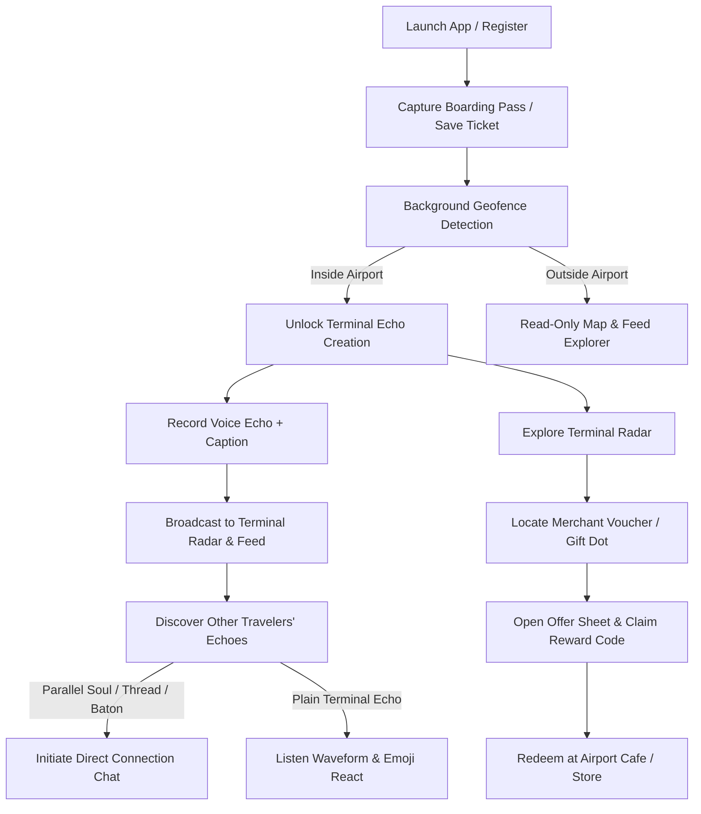

# Gate Closes — System Documentation

> System Discovery & Connection Audit (task 1 of `NEXT_SESSION.md`).
> Built from the code, not from the older docs. Status marks:
> ✅ Confirmed · ⚠️ Partial · ❌ Broken · ❓ Unknown.
>
> | Step | State |
> | :--- | :--- |
> | 1 Inventory from code | ✅ done 2026-10-09 |
> | 2 Feature inventory | ✅ done 2026-10-09 (§3, §10, §11) |
> | 3 End-to-end traces | ✅ done 2026-10-09 (§3.5, T1–T10) |
> | 4 Socket.IO table | ✅ done 2026-10-09 (§7.1, §7.2) |
> | 5 Database relationships | ✅ done 2026-10-09 (§6.3, §6.4) |
> | 6 External services & env | ✅ done 2026-10-09 (§8) |
> | 7 Journeys on phones | ✅ done 2026-10-09 (realme physical device, profile build, API port 3005) (§7.3) |
> | 8 Final write-up | ✅ done 2026-10-09 (§1, §2, §7.3, §14, §15) |
>
> Repos audited (heads on 2026-10-09): app-v2 `feat/design-3d-map` `dc8d4fa`,
> API `feat/airport-offers-and-access` `5e484aa`, landing
> `feat/landing-revamp` `d46ec23`.
>
> Status in step 1 means "wired in code" only. ✅ here = both ends exist in
> code and match; it does **not** yet mean it was traced or seen on a device
> (steps 3 and 7).

---

## 1. What Gate Closes is

**Gate Closes** is a proximity- and itinerary-synchronized airport social and commercial platform designed to connect air travelers during transit (layovers, departures, arrivals) and provide hyper-localized discovery within airport terminals.

### Core Value Proposition & Tenets
1. **Hyper-Localized Transient Community**: Social interactions are rooted in physical airport space and time. Unlike persistent social networks, Gate Closes creates temporary connections that exist while travelers share the same physical airport environment or overlapping flight paths.
2. **Flight-Synchronized Serendipity (Connections)**: Using machine-readable boarding pass data (PDF417, Aztec, QR, or OCR image capture), the platform algorithmically detects travelers whose journeys intersect:
   - **Parallel Soul**: Travelers sharing the exact same flight number and date.
   - **Destination Thread**: Travelers departing for the same arrival destination from different origins or connecting through the same hub.
   - **Baton Touch**: Connecting travelers handing off or crossing paths at a shared transit hub.
3. **Terminal Pulse & Voice Memos (Terminal Echo)**: Time-decaying, geofence-gated audio and text broadcasts (max 10 seconds audio). Travelers inside an airport can record and publish voice memos that appear on localized radar displays and airport feeds. Outside the geofence, travelers can listen and explore, but creation is strictly guarded.
4. **Interactive 3D / Lite Radar World Map**: A Mapbox-driven spatial canvas that scales from global airport activity clusters (showing active echo volumes across the globe) down to terminal-level radar sweep grids, echo pins, and merchant discovery pins.
5. **Contextual Airport Commerce (Offers & Vouchers)**: Dynamic airport merchant promotions (vouchers, gifts, and advertisements) placed pseudo-randomly within terminal boundaries, uniquely fixed per user per day, with verifiable claim redemption and anti-double-claim enforcement.

---

## 2. Main user journey

The primary user journey spans onboarding, airport geofence arrival, terminal discovery, localized social interaction, and commercial redemption.



### Step-by-Step Walkthrough

1. **Onboarding & Ticket Ingestion**
   - User signs up via 4-step email verification or logs in with existing credentials.
   - User scans physical boarding pass via camera (barcode decoder or ML Kit OCR) or enters flight details manually.
   - Flight ticket is persisted (`flightTicket` collection) and sets up traveler transit state (departure/arrival airports, times, flight number).
2. **Arrival & Geofence Boundary Detection**
   - Device location (GPS) is evaluated against airport coordinates (`location: 2dsphere`) and administrative radius (`radiusKm`).
   - If user is outside the airport, an informational barrier is enforced: the app allows browsing feeds and viewing radar pins globally, but attempting to post an echo triggers the "Outside Airport" barrier dialog (`EchoOutsideAirportError: 422`).
3. **Terminal Echo Feed & Radar Map Exploration**
   - Inside the terminal, user switches between the **Feed** (chronological list of voice memos and text snippets) and the **Map** (spatial radar display).
   - Zooming into the airport switches the map from regional cloud heatmaps to an interactive radar sweep with concentric range rings and directional bearings.
   - Listening to an echo plays audio via the custom waveform player; reaching 70% duration triggers the listen counter (`countListens`). Emoji reactions broadcast live over Socket.IO to connected travelers in the airport room (`airport:<IATA>`).
4. **Affinity Matching & 1-on-1 Conversations**
   - When browsing echoes or terminal pins, echoes from travelers with matching flight itineraries display affinity badges: **Parallel Soul** (same flight), **Destination Thread** (same arrival), or **Baton Touch** (layover crossover).
   - Tapping an affinity echo reveals a **START CONVERSATION** action, opening a 1-on-1 direct message draft (`/connections/dm/:userId?type=`).
   - The first message sent establishes a mutual conversation thread (`conversations` collection), enabling direct transit communication.
5. **Radar Voucher Discovery & Redemption**
   - Navigating within the terminal radar reveals merchant offer dots (vouchers, complimentary gifts, sponsored ads).
   - Tapping an offer dot opens the **Offer Sheet**, detailing the merchant promotion and expiration.
   - Tapping **Claim** atomically secures the voucher reward code (e.g. `GATE-BAG-COFFEE`) and updates claim limits.
   - Attempting to claim the same voucher again is immediately refused with `409 Conflict` (`"You already claimed this offer."`).

## 3. Feature inventory

App feature folders (`lib/features/`): `airport`, `auth`,
`boarding_pass`, `connections`, `flight`, `profile`, `terminal_echo`,
`worldMap`. 189 Dart files, 24.4k lines.

Status here (step 2) = wired in code and both ends agree, checked by reading
the page → controller → repository → API route → service. Steps 3 and 7
will confirm the behaviour end to end and on a phone.

### 3.1 Mobile app (app-v2)

| # | Feature | What it does | Where | Data / storage | Realtime | Status |
| :--- | :--- | :--- | :--- | :--- | :--- | :--- |
| F1 | Sign up | 4 steps: email → 4-digit code (mailed) → password → username + gender | `/register` · `RegisterController` | server: `user`, `user.auth`, `verification.code`; SMTP | no | ✅ |
| F2 | Login, session, logout | email + password; access token refreshed on 401; logout revokes the refresh token | `/login`, Profile · `AuthController`, `auth_interceptor` | server + Redis `refresh:*`; tokens on device (`StorageService` / cookies) | no | ✅ |
| F3 | Forgot password | code → verify → new password → logged in | `/forgot-password` · `ForgotPasswordController` | `verification.code`, `user.auth` | no | ✅ |
| F4 | Onboarding | welcome, username + gender (`edit-profile`), boarding pass step; "seen" flag per user id | `/onboarding` (forced once by router) | flag local; profile + ticket on server | no | ✅ |
| F5 | Boarding pass capture | live barcode (PDF417/Aztec/QR/DataMatrix), photo/screenshot → barcode-in-image then ML Kit OCR, or manual; all end in one confirm form; no name/PNR kept | `BoardingPassScannerSheet` (onboarding, `/add-boarding-pass`) | on device (ML Kit), then F6 | no | ⚠️ works; parser accuracy frozen until 20+ real fixtures; debug-only fixture capture |
| F6 | Flight ticket | the app shows one ticket (in transit / next / latest): view, add, edit, delete | Profile · `FlightController` | `flightTicket` | no | ⚠️ several tickets per user possible; edit may hit another one (T4) |
| F7 | Airport detection | GPS → nearest airport and inside/outside its radius; map re-detects every 250 m; last position kept 15 min | Feed, map, create echo · `AirportController` | `airport` (+ `radiusKm` set in admin) | no | ✅ |
| F8 | Feed | echoes of the detected airport (or one picked in airport search), newest first | `/feed`, `/feed/airport-search` · `TerminalEchoController.loadFeed` | `terminal.echo` + `file` + reactions | yes: `airport:<IATA>` new echoes, reactions | ⚠️ no paging (returns every echo of the airport); IATA sent as `airportName` and matched as IATA **or** name regex |
| F9 | Post an echo | voice (≤10 s, required) + optional caption, uploaded then posted | `/feed/create` · `CreateEchoPage` | S3 via `/s3/upload` → `file`; `terminal.echo` | broadcasts `terminal_echo:changed` | ⚠️ outside the radius the app offers "post anyway", but the API always refuses with 422 (`EchoOutsideAirportError`) |
| F10 | Echo thread | replies (voice/text), reactions, listen count | `/feed/thread/:id` · `TerminalEchoThreadController` | `terminal.echo.reply`, `.reply.reaction` | yes: `thread:<id>` | ✅ |
| F11 | Reactions & listens | 6 emoji; listen counted once at 70 % played | echo card, thread, players | `*.reaction`, `countListens` | reactions live | ⚠️ echo listen endpoint unauthenticated |
| F12 | World map | Mapbox 3D or lite by device; counts per airport zoomed out, echo pins per airport (≤8 airports) zoomed in, boundaries, tags, clouds, radar, country tap; render guard (25 s) | `/` · `WorldMapController`, `WorldMapPage` | `/terminal-echo/map(/counts)`, `/airport/geojson` (Redis-cached), disk cache | yes: `terminal_echo:changed` (new echoes only) per airport room | ✅ (device-checked in earlier sessions) |
| F13 | Echo card → start conversation | tapped pin opens a card; PS / DT / BT pins offer START CONVERSATION → draft thread | `/map/echo/:id?type=` → `/connections/dm/:userId?type=` | affinity computed by the API from both tickets | no | ✅ wired |
| F14 | Offers on the map | vouchers / gifts / ads as hidden dots at a per-user-per-day random spot; sheet logs `view` / `click`; Claim reveals the reward | map → `OfferSheet` | `offer`, `offer.event` | no | ⚠️ claim: per-user limit only if `maxClaimsPerUser` is set (seeded vouchers/gifts: 1; ads: none), checked by count-then-insert (not atomic) |
| F15 | Connections inbox | three tabs (Parallel Soul, Destination Thread, Baton Touch), unread state | `/connections` · `ConnectionsController` | `conversations`, read states | yes: `conversation:updated` on `user:<id>` | ⚠️ wired; current collections empty — legacy `ps/bt/dt*` data not shown |
| F16 | Message thread | voice and text messages, reactions, mark read; draft becomes a conversation on first send (eligibility checked by strategy) | `MessageThreadPage` · `MessageThreadController` | `conversation.messages`, `.reaction`, `conversationReadStates`, `file` | yes: `message:received`, `reaction:updated` | ✅ wired |
| F17 | Profile | profile + active ticket, edit profile, change password, theme, map lighting, logout | `/profile*` | `user`, `flightTicket`; theme and lighting local | no | ✅ |
| F18 | Map lighting | dusk/night presets or automatic | `/profile/map-lighting` | local storage | no | ✅ (3D map only) |
| F19 | Offline | disk cache of boundaries and pins; connectivity banner | map | local | no | ✅ |

### 3.2 Landing site (gate-closes-landing, Next.js 16)

| # | Feature | Calls | Status |
| :--- | :--- | :--- | :--- |
| L1 | Marketing page, OG image, robots, sitemap | none | ✅ |
| L2 | Contact form | none — builds a `mailto:` link | ✅ (no backend) |
| L3 | Admin login / logout / session | `/auth/login`, `/auth/logout`, `/auth/me`, `/auth/refresh` via `/backend/*` rewrite; `proxy.ts` sends cookie-less visitors to `/admin/login` | ✅ |
| L4 | Admin offers (list, create, edit, delete, stats) | `/admin/offers*` | ✅ |
| L5 | Admin users (list, set role) and roles (CRUD, permission catalog) | `/admin/users*`, `/admin/roles*`, `/admin/permissions` | ✅ |
| L6 | Admin airports (radius per airport) | `/admin/airports*` | ✅ |

### 3.3 Server-only features (no client)

Google sign-in, airport boundary sync and crawl, presigned S3 URLs, change
username / gender, DM existence check (see §13).

### 3.4 Corrections to older docs found in step 2

- `FLUTTER_V2_SYSTEM_ARCHITECTURE.md` §4.3 says saving a ticket "triggers
  backend affinity matching". It does not: `FlightTicketSvc.create` only
  stores it; the affinity (`TerminalEchoSvc.computeType`) is computed when
  echoes are read (`getMap`, `getById`).
- §4.6 "Claim … once per user" holds only for offers whose
  `limits.maxClaimsPerUser` is set.

### 3.5 End-to-end traces (step 3, code read at every hop)

API code read on `feat/airport-offers-and-access` (`5e484aa`); reset code
also on `origin/main`.

**T1 Sign up** — `RegisterForm` → `RegisterController.submitEmail` →
`POST /auth/register-email` → `UserAuthSvc.registerEmailAndSendOtp` (creates
`user` with `signupStep`, 4-digit code bcrypt-hashed in `verification.code`,
mail) → returns `userId`. `verify-email {userId, code}` (5 attempts, expiry)
→ `signupStep: set_password`. `set-password {userId, …}` requires that step
→ `signupCompleted`. `set-username-gender {userId, …}` → `isCompleteProfile`
(❌ C2: no step check). App then logs in. ✅ apart from C2.

**T2 Login / refresh** — `POST /auth/login` → tokens in the body for the
app, cookies (`session_token`, `refresh_token`) for web clients. Refresh
rotates: the old `jti` is marked rotated in Redis; reusing a rotated token
revokes the whole family; tokens with no Redis record still pass (Redis was
down when issued). Logout revokes the family and clears cookies. ✅

**T3 Forgot password** — `forgot-password {email}` → returns `userId` (404
for unknown email) → `verify-reset-code` → `reset-password {userId, …}`.
❌ C1: the reset did not require the verified code (fix written, §12.0). The
app logs in with the new password afterwards.

**T4 Boarding pass → ticket** — scanner sheet (barcode / photo OCR /
manual) → confirm form → `FlightController.saveFlightTicket` → POST (new)
or PUT (editing) `/flight-ticket` with an `Idempotency-Key` header. API:
controller reads the header; `FlightTicketSvc.create` returns the existing
ticket for a repeated key or for the same flight + route + departure; airport
names and countries are looked up from the codes (unknown code → error);
arrival is estimated from distance when missing; a unique index on
`(userId, idempotencyKey)` handles races. ✅
- ⚠️ Users can have several tickets (DB: 4 of 9 ticket owners have 2). GET
  returns the in-transit, else the next upcoming, else the latest ticket,
  but PUT does `findOneAndUpdate({userId})` — whichever ticket Mongo finds
  first — so an edit can change a different ticket from the one shown.
  DELETE removes all of the user's tickets. Not reproduced on a device.

**T5 Airport detection** — Geolocator → `AirportController.detectAirport`
→ `GET /airport/check-inside-airport?lat&lng` → `AirportRepo.findNearestWithDistance`
(`$geoNear` on `location`, inside = distance ≤ `radiusKm`). DB: all 3,478
airports have a location, an IATA code, a boundary and a radius (2.5–4 km).
✅

**T6 Map pins and their type** — `GET /terminal-echo/map?airport=` →
`TerminalEchoSvc.findAllWithType`: the viewer's ticket and each sender's
ticket (in-transit / upcoming / latest) → `computeType`: same from + to →
Parallel Soul; same destination, arrivals within 24 h, different flight and
origin → Destination Thread; one's destination is the other's origin →
Baton Touch; else Terminal Echo. GeoJSON properties carry no sender id. ✅
- The conversation eligibility strategies apply the same rules, so a
  coloured pin's START CONVERSATION is accepted. (Pin typing compares codes
  as stored; eligibility upper-cases them.)
- ❓ Product: Parallel Soul ignores dates, and the "latest" ticket is used
  even long after the trip, so old tickets keep matching people.

**T7 Post an echo** — record (≤10 s) → `POST /s3/upload` (multipart) →
`S3Svc.uploadFile` (extension must be audio, ≤10 MB) → `file` URL →
`POST /terminal-echo` (session, echo rate limit, idempotency) →
`createTerminalEcho`: nearest airport must contain the point (else 422),
`file` row, location rounded to 3 decimals (~110 m), canonical
`airportIata` → `broadcastToAirportRoom('terminal_echo:changed')` → app feed
and map sockets in `airport:<IATA>` add it. ✅
- ⚠️ `/s3/upload` uses multer memory storage with no size limit, so the
  whole upload is held in memory before the 10 MB check; the type check is
  the file extension only.
- ⚠️ `POST /terminal-echo` accepts any `fileUrl` URI, not only this API's
  bucket; other users' players would load it.

**T8 Thread** — `EchoThreadLoaderPage` → `GET /terminal-echo/:id` +
`GET /terminal-echo-reply?terminalEchoId=` → reply via upload +
`POST /terminal-echo-reply` → emits `terminal_echo_reply:created` to
`thread:<id>` (the app listens) and `terminal_echo:reply_added` to the
airport room (nobody listens). ✅

**T9 Offers** — `GET /offers?airport=` → live offers for that airport or
`*`, pin spot seeded by offer + user + day → map dot → `OfferSheet`:
`POST /offers/:id/events {type: view|click}` → `offer.event` and
`offer.stats` → Claim → `OfferSvc.claim`: live check, per-user count,
atomic `takeClaim` against `maxClaims`, `claim` event, returns the private
`reward`. ✅ wired.
- ⚠️ Per-user limit is count-then-insert (two quick claims can both pass).
- ❓ Product: no location check — any logged-in user can list any airport's
  offers and claim them from anywhere; `airport` in the body is only a label.
- Every sheet opening counts a `view` (no de-duplication).

**T10 Start a conversation** — echo card START CONVERSATION →
`/connections/dm/:userId?type=` → `MessageThreadController.openDraft` looks
for an existing conversation of that type with that user (list call) →
first send `_ensureConversation` → `POST /conversations {type, otherUserId}`
→ `ConversationSvc.createDm`: both tickets, eligibility strategy, `dmKey`
per type + pair (unique index; existing → 409, which the app resolves by
re-reading the list) → join `<conversationId>` room → `POST
/:id/messages` → `message:received` to the room and `conversation:updated`
to both `user:<id>` rooms. Text and voice both supported. ✅
- Creating the conversation itself sends no `conversation:updated`; the
  other traveler sees it on the first message.

## 4. Flutter architecture

### 4.1 Routes (`lib/routes/app_routes.dart`, go_router)

Redirect guard: not logged in → `/login` (only login, register,
forgot-password allowed); logged in but onboarding not seen (stored per user
id in `StorageService`) → `/onboarding`; logged in on a pre-auth page → `/`.

| Path | Page | Notes |
| :--- | :--- | :--- |
| `/login` | `LoginPage` | |
| `/register` | `RegisterPage` | 4-step signup wizard |
| `/forgot-password` | `ForgotPasswordPage` | 4-step reset wizard |
| `/onboarding` | `OnboardingPage` | last step embeds `BoardingPassScannerSheet` |
| `/` (shell) | `WorldMapPage` | home; 2,967 lines |
| `/connections` (shell) | `ConnectionsPage` | |
| `/feed` (shell) | `FeedPage` | |
| `/profile` (shell) | `ProfilePage` | |
| `/feed/create` | `CreateEchoPage` | |
| `/feed/thread/:echoId` | `EchoThreadLoaderPage` → `EchoThreadPage` | `extra` = preloaded echo |
| `/feed/airport-search` | `AirportSearchPage` | |
| `/map/echo/:echoId?type=` | `EchoPreviewDialog` (dialog page) | `type` = affinity key |
| `/add-boarding-pass` | `AddBoardingPassPage` | `extra` = ticket to edit |
| `/profile/edit` | `ProfileEditorPage` | |
| `/profile/change-password` | `ChangePasswordPage` | |
| `/profile/map-lighting` | `MapLightingPage` | |
| `/connections/dm/:otherUserId?type=` | `MessageThreadPage.draft` | conversation that may not exist yet |

Shell (`MainLayout` + `MapBottomNav`): `/`, `/connections`, `/feed`, `/profile`.

### 4.2 Layers per feature

| Feature | Data (datasource / repository) | Presentation (controllers) |
| :--- | :--- | :--- |
| auth | `auth_remote_datasource`, `auth_repository` | `auth_controller`, `register_controller`, `forgot_password_controller` |
| profile | `profile_remote_datasource`, `profile_repository` | `profile_controller` |
| airport | `airport_repository_impl` | `airport_controller` |
| flight | `flight_repository_impl` | `flight_controller` |
| boarding_pass | `ml_kit_ticket_image_reader`; parsers `bcbp`, `ocr`, `manual_flight`; coordinator, confidence engine, normalizer, extraction pipeline | `ticket_extraction_providers` (no API calls — saves via flight) |
| terminal_echo | `terminal_echo_repository_impl`, `terminal_echo_reply_repository_impl`, `terminal_echo_socket_service` | `terminal_echo_controller`, `terminal_echo_thread_controller` |
| connections | `connections_repository_impl`, `messages_repository_impl`, `conversation_socket_service` | `connections_controller`, `message_thread_controller` |
| worldMap | `echo_map_repository_impl`, `offer_map_repository_impl`, `map_echo_socket`, `map_disk_cache`, `device_capabilities_source` | `world_map_controller`, `map_tier_controller`, `map_render_guard`, `map_lighting_controller` |

Core services (`lib/core/services/`): `api_service` (Dio), `auth_interceptor`
(token attach + refresh on 401, skips login/refresh), `authenticated_socket`
(re-reads token on each handshake; on server rejection revalidates the
session and reconnects with backoff up to 30 s), `cookie_service`,
`storage_service`, `file_upload_service`, `connectivity_service`,
`theme_controller`. `core/airports/` has a local airport registry and code
validator; `core/location/` wraps Geolocator.

### 4.3 HTTP calls made by the app (from `ApiEndpoints` usage)

| Caller | Method + path | API route exists |
| :--- | :--- | :--- |
| auth_remote_datasource | POST `/auth/login` | ✅ |
| | POST `/auth/register-email`, `/verify-email`, `/resend-code`, `/set-password`, `/set-username-gender` | ✅ |
| | POST `/auth/forgot-password`, `/resend-reset-code`, `/verify-reset-code`, `/reset-password` | ✅ |
| | POST `/auth/logout`, GET `/auth/me`, PATCH `/auth/edit-profile`, POST `/auth/change-password` | ✅ |
| auth_interceptor | POST `/auth/refresh` | ✅ |
| profile_remote_datasource | GET `/auth/me` | ✅ |
| airport_repository_impl | GET `/airport/check-inside-airport`, `/airport/search`, `/airport/nearby`, `/airport/geojson` | ✅ |
| flight_repository_impl | GET / POST / PUT / DELETE `/flight-ticket` | ✅ |
| file_upload_service | POST `/s3/upload` (multipart, audio) | ✅ |
| offer_map_repository_impl | GET `/offers`, POST `/offers/:id/events`, POST `/offers/:id/claim` | ✅ |
| echo_map_repository_impl | GET `/terminal-echo/map`, `/terminal-echo/map/counts` | ✅ |
| terminal_echo_repository_impl | GET `/terminal-echo`, GET `/terminal-echo/:id`, POST `/terminal-echo`, PATCH `/:id/reaction`, PATCH `/:id/listen` | ✅ |
| terminal_echo_reply_repository_impl | GET / POST `/terminal-echo-reply`, PATCH `/:id/reaction`, PATCH `/:id/listen` | ✅ |
| connections_repository_impl | GET / POST `/conversations`, GET `/conversations/search` | ✅ |
| messages_repository_impl | GET / POST `/conversations/:id/messages`, PATCH `/:id/messages/:mid/reaction`, POST `/:id/read` | ✅ |

`ApiEndpoints` constants never used: `airportCheckBoundary`, `googleAuth`,
`conversationExistence`, `conversationById` (❓ — kept; Google sign-in is not
in the app).

### 4.4 Socket use in the app

See §7.

## 5. API architecture

Express 4 + MongoDB driver (no ODM) + Redis + Socket.IO, TypeScript.
`package.json` name is still `template-api-node`. Layers:
routes → controllers → services → repositories → collections; `src/domain/`
holds access permissions, airport scope and conversation eligibility
strategies (`baton.touch`, `destination.thread`, `parallel.soul`).

Global middleware (`src/app.ts`): request id, CORS (no-origin allowed; else
`ALLOWED_ORIGINS` or allow-any), cookie-parser, JSON, helmet. Health routes
are mounted at the root, un-throttled; everything else is under `/api` with
`generalRateLimiter`.

### 5.1 Endpoints

Auth column: S = `sessionMiddleware`, P(x) = `requirePermission(x)`,
RL = `authRateLimiter`, I = idempotency, ER = echo-creation rate limiter.
"Used by": A = app-v2, L = landing admin, — = no client found.

| Route | Auth | Used by | Status |
| :--- | :--- | :--- | :--- |
| GET `/health`, `/readiness` (root) | none | probes | ✅ |
| GET `/api/v1` | none | — | ❓ welcome stub |
| POST `/auth/register-email`, `/verify-email`, `/resend-code` | RL | A | ✅ |
| POST `/auth/set-password`, `/set-username-gender` | none (step token in body?) | A | ⚠️ check in step 3 how the step is authorised |
| POST `/auth/forgot-password`, `/resend-reset-code`, `/verify-reset-code`, `/reset-password` | RL | A | ✅ |
| POST `/auth/login`, `/refresh` | RL | A, L | ✅ |
| POST `/auth/logout` | none | A, L | ✅ |
| POST `/auth/login-or-register-google` | RL | — | ❓ no client calls it |
| GET `/auth/me` | S | A, L | ✅ |
| POST `/auth/change-password` | S | A | ✅ |
| POST `/auth/change-username`, `/change-gender` | S | — | ❓ app uses `edit-profile` instead |
| PATCH `/auth/edit-profile` | S | A | ✅ |
| POST `/s3/upload` | S | A | ✅ |
| POST `/s3/get-presigned-url`, GET `/s3/get-cloudfront-url` | S | — | ❓ |
| GET `/terminal-echo` | S | A | ✅ |
| GET `/terminal-echo/map`, `/map/counts` | S | A | ✅ |
| GET `/terminal-echo/:id` | S | A | ✅ |
| POST `/terminal-echo` | S, ER, I | A | ✅ |
| PATCH `/terminal-echo/:id/listen` | **none** | A | ⚠️ unauthenticated counter bump |
| PATCH `/terminal-echo/:id/reaction` | S | A | ✅ |
| GET `/terminal-echo-reply` (`?terminalEchoId=`) | S | A | ✅ |
| GET `/terminal-echo-reply/:id` | S | ❓ | ❓ comment says the app uses it; app-v2 does not |
| POST `/terminal-echo-reply`, PATCH `/:id/listen`, `/:id/reaction` | S | A | ✅ |
| GET `/airport/search`, `/nearby`, `/check-inside-airport` | S (router-level) | A | ✅ |
| GET `/airport/check-inside-airport-boundary`, `/check-inside-specific-airport` | S | — | ❓ |
| POST `/airport/boundary/sync`, `/airport/crawl` | S, P(airports:manage) | — | ❓ ops endpoints, no client |
| GET `/airport/geojson` | S (twice: router + route) | A | ✅ (double middleware is harmless) |
| GET / POST / PUT / DELETE `/flight-ticket` | S | A | ✅ one ticket per user (no id in path) |
| GET / POST `/conversations` (POST: I) | S | A | ✅ |
| GET `/conversations/search` | S | A | ✅ |
| GET `/conversations/existence`, `/conversations/:id` | S | — | ❓ |
| POST `/conversations/:id/read`; GET / POST `/:id/messages`; PATCH `/:id/messages/:mid/reaction` | S | A | ✅ |
| GET `/offers`, POST `/offers/:id/events`, `/offers/:id/claim` | S | A | ✅ |
| `/admin/offers` GET, POST, GET `/:id`, PATCH, DELETE, GET `/:id/stats` | S, P(offers:read / write) | L | ✅ |
| `/admin/users` GET, PATCH `/:id/role` | S, P(users:read / users:role) | L | ✅ |
| `/admin/roles` GET, POST, PATCH `/:name`, DELETE `/:name` | S, P(read / manage) | L | ✅ |
| GET `/admin/permissions` | S, P(users:read) | L | ✅ |
| `/admin/airports` GET, PATCH `/:id/radius` | S, P(airports:manage) | L | ✅ |
| `todo.route.ts` (POST/PUT/DELETE) | — | — | ❓ **not mounted**; template leftover with `todo.*` controller/service/repo/model writing to `organizations` |

## 6. Database architecture

MongoDB Atlas, database `gate-closes` (shared dev DB; the API reads
`MONGO_DB`; `MONGO_DB_DEV` is declared in `config.ts` but used nowhere).
19 model files in `src/models/`.

### 6.1 Collections on 2026-10-09 (read-only count)

| Collection | Docs | Written by current code | Status |
| :--- | ---: | :--- | :--- |
| `airport` | 3,478 | airport repo / scripts | ✅ |
| `airport.removed` | 4,526 | `clean-airports` script (archive) | ✅ archive |
| `user` | 16 | user repo | ✅ |
| `user.auth` | 16 | user.auth repo | ✅ |
| `verification.code` | 3 | verification.code repo | ✅ |
| `role` | 5 | role repo / seeder | ✅ |
| `flightTicket` | 13 | flight.ticket repo | ✅ |
| `flight.ticket` | 0 | nothing | ❓ empty legacy collection |
| `terminal.echo` | 26 | echo repo | ✅ |
| `terminal.echo.reaction` | 32 | | ✅ |
| `terminal.echo.reply` | 14 | | ✅ |
| `terminal.echo.reply.reaction` | 9 | | ✅ |
| `file` | 21 | file repo (uploads) | ✅ |
| `offer` | 6 | offer repo | ✅ |
| `offer.event` | 89 | offer repo (views/taps/claims) | ✅ |
| `conversations` | **0** | conversation repo | ⚠️ current code's collection, still empty |
| `conversation.messages` | **0** | conversation.message repo | ⚠️ same |
| `conversation.messages.reaction`, `conversationReadStates` | not present yet | repos | ⚠️ created on first write |
| `psConversation*`, `btConversation*`, `dtConversation*` (4 each: conversation, message, message.reaction, read state) | 4 / 16–20 / 3–5 / 8 per type | only the seeder (`npm run seed`, `conversations.seeder.ts`) | ⚠️ the earlier per-type conversation layout; the API no longer reads it, but the demo seeder still writes demo conversations there (step 5) |
| `logs` | 325 | `winston-mongodb` transport (`utils/logger.ts`) | ✅ (logs stored in the app DB) |
| `organizations` | not present | only the unmounted `todo` repo | ❓ |

### 6.2 Models with no references

`fs.conversation.model`, `fs.conversation.message.model`,
`fs.conversation.user.model`, `sovereign.future.signal.model` — no file
imports them (❓ legacy; keep). `todo.model` is only used by the unmounted
todo route.

### 6.3 Relationships (step 5)

```
user ─1:1─ user.auth (password or googleId, provider local|google)
  │  └─ role (by name: user, user_premium, developer, admin, super_admin;
  │           12 of 16 users have no role field → treated as plain user)
  ├─1:n─ verification.code (purpose email_verify | reset_password)
  ├─1:n─ flightTicket (from/to airport codes → airport.iata; the flight
  │        lives on the ticket, there is no Flight model)
  ├─1:n─ terminal.echo (senderId; airportIata → airport.iata; fileId → file)
  │        ├─1:n─ terminal.echo.reaction (userId, one row per user+emoji;
  │        │        counters countReact* kept on the echo)
  │        └─1:n─ terminal.echo.reply (senderId, fileId optional = text reply)
  │                 └─1:n─ terminal.echo.reply.reaction
  ├─n:m─ conversations (participants[2], type, dmKey unique per type+pair)
  │        ├─ conversation.messages (+ .reaction), conversationReadStates
  └─1:n─ offer.event (view | click | claim) ─n:1─ offer (airports[] IATA or
           "*", limits, stats counters, private reward)
airport (iata, location, boundary, radiusKm) ← echo.airportIata,
         ticket codes, offer.airports, map, detection
```

Affinity between two travelers is not stored: it is computed from their
tickets on every read (§3.5 T6), and the conversation `type` freezes the
affinity that existed when it was created.

### 6.4 Integrity check (read-only, 2026-10-09)

| Reference | Result |
| :--- | :--- |
| `user.auth`, `verification.code`, `flightTicket`, `terminal.echo`, replies, reactions → `user` | 0 dangling |
| `terminal.echo.airportIata` → `airport.iata` | 0 dangling (echoes at MNL 17, JFK 2, LAX 2, SYD 2, FRA, BAG, DXB 1) |
| echo / reply `fileId` → `file` | 0 dangling; 13 echoes and 8 replies have no file |
| replies → echo, reply reactions → reply, echo reactions → echo | 0 dangling |
| `file` rows used by nothing | 0 of 21 |
| `offer.event.offerId` → `offer` | 0 dangling |
| `offer.event.userId` → `user` | **6 dangling** (users removed by a reseed; the wipe keeps offers and their events) |
| echo reaction counters vs reaction rows | 5 differ — exactly the 5 `[crowd-test]` echoes (inserted with counters and no rows) |
| `user.auth` per user | exactly 1 each; 14 local, **2 Google** |
| users with signup or profile unfinished | 1 |
| legacy `ps/bt/dt` conversations | 12; every participant still exists; latest activity 2026-09-30 |

Data the app cannot produce or never uses:
- Echoes without audio: 5 `[crowd-test]` + 8 from the demo seeder
  (`terminal-echo.seeder.ts` gives some echoes no file); the API now requires
  audio for new echoes. The app shows them as text only (`isVoiceMemo`
  guard).
- `countReactions` on 5 echoes (crowd-test only; no model field).
- `airport.radiusManual` on 2 airports (set by the admin radius page).
- Ticket `boardingDateTime`, `gate`, `seat`, `terminal`, `returnDateTime`
  are stored; whether the app shows them: ❓ (not traced).
- `user.picture`: stored for all users; no upload in app-v2 (❓).
- Collections `flight.ticket` (empty), `airport.removed` (archive), `logs`.

Seeder vs current API (`src/seeders/`):
- `npm run seed` writes demo conversations into the legacy `ps/bt/dt*`
  collections, which the API no longer reads, so seeded demo users have no
  visible conversations in app-v2.
- `wipe-demo-data.ts` clears the legacy collections but **not** the current
  `conversations`, `conversation.messages`, `conversation.messages.reaction`
  and `conversationReadStates`: after real use, a reseed would leave
  conversations whose participants no longer exist (they are empty today).

## 7. Socket.IO architecture

Server (`src/app.ts`): one `Server` on the HTTP server, Redis adapter
(`@socket.io/redis-adapter`, falls back to in-memory if Redis is down).

| Namespace | Auth (handshake) | Rooms |
| :--- | :--- | :--- |
| `/terminal-echo` | JWT from `auth.accessToken` or `Authorization` header | `airport:<IATA>` (via `join_airport`), any room name via `join_map` (app uses `thread:<echoId>`) |
| `/conversations` | JWT from `auth.token` or header | `user:<userId>` (auto on connect), `<conversationId>` (on `join_conversation`, participant checked in DB) |
| `/organizations-owner-<24 hex>` | none | none — only logs connect/disconnect | 

### 7.1 Who connects (app)

| App socket | Namespace | Opened when | Rooms joined |
| :--- | :--- | :--- | :--- |
| `MapEchoSocket` (`WorldMapController`) | `/terminal-echo` | map shows pins | `airport:<IATA>` for every airport whose pins are on screen (≤8); joins/leaves as the view changes; rejoins after reconnect |
| `TerminalEchoSocketService.connectAirport` (`TerminalEchoController`) | `/terminal-echo` | feed loads an airport | `airport:<IATA>` of the feed's airport |
| `TerminalEchoSocketService.connectThread` (`TerminalEchoThreadController`) | `/terminal-echo` | echo thread opened | `thread:<echoId>` (via `join_map`) |
| `ConversationSocketService` (`ConnectionsController`) | `/conversations` | Connections tab | `user:<me>` (automatic) |
| `ConversationSocketService` (`MessageThreadController`) | `/conversations` | message thread opened / draft created | `user:<me>` + `<conversationId>` |

Each is a separate connection (`enableForceNew`), authenticated on every
(re)connect by `AuthenticatedSocket`; a rejected handshake refreshes the
session and retries with backoff (≤30 s).

### 7.2 Events (step 4: trigger → payload → receiver → UI)

| Event | Dir | Room | Trigger (API) | Payload | App receiver → UI | Status |
| :--- | :--- | :--- | :--- | :--- | :--- | :--- |
| `terminal_echo:join_airport` / `leave_airport` | C→S | `airport:<IATA>` (upper-cased) | — | `{airportIata}` | map + feed sockets | ✅ |
| `terminal_echo:join_map` / `leave_map` | C→S | any name sent | — | `{room}` | thread socket (`thread:<id>`) | ⚠️ server accepts any room name |
| `terminal_echo:changed` | S→C | `airport:<IATA>` | `POST /terminal-echo` | `{type:'create', data}` where `data` = `createTerminalEcho`'s result = `{acknowledged, insertedId, airportIata, airportName}` (an insert result, **not** the echo) | map: reads `data.airportIata`, drops cached pins/counts for it and reloads → ✅ · feed: `TerminalEchoModel.fromJson(data)` → echo with empty id, text and audio, prepended | ❌ feed (see §12 #17) · ✅ map |
| `terminal_echo:reaction_updated` | S→C | `airport:<IATA>` | `PATCH /terminal-echo/:id/reaction` | `{terminalEchoId, reactionKey, action: increment\|decrement, triggeredByUserId}` | feed: ±1 on that echo's count (the reactor relies on this too — no optimistic change) | ✅ · ⚠️ an open thread page is not in the airport room unless the feed socket is, so its header count may not move |
| `terminal_echo:reply_added` | S→C | `airport:<IATA>` | `POST /terminal-echo-reply` | `{terminalEchoId}` | none in app-v2 (the retired Expo app listened to it) | ❓ legacy for Expo; app-v2 shows no reply counts |
| `terminal_echo_reply:created` | S→C | `thread:<echoId>` | `POST /terminal-echo-reply` | `{terminalEchoId, reply}` (full reply via `findReplyById`) | thread: prepend if id is new (the sender's own reply is de-duplicated) | ✅ |
| `terminal_echo_reply:reaction_updated` | S→C | `thread:<echoId>` | `PATCH /terminal-echo-reply/:id/reaction` | `{replyId, reactionKey, action, triggeredByUserId}` | thread: ±1 on that reply | ⚠️ the reactor already changed the count optimistically and also gets this event (handler ignores `triggeredByUserId`) → own reaction counted twice until reload (§12 #18) |
| `join_conversation` / `leave_conversation` | C→S | `<conversationId>` | — | `{conversationId}` | thread socket | ✅ join checks participation in DB; leave has no check (harmless) |
| `conversation:updated` | S→C | `user:<id>` of each participant | message sent, message reaction | `{conversationId}` | inbox: re-fetches the whole list | ✅ (not sent when a conversation is created, only on its first message) |
| `message:received` | S→C | `<conversationId>` | `POST /conversations/:id/messages` | full message (`findByIdWithDetails`) | thread: append if id is new | ✅ |
| `reaction:updated` | S→C | `<conversationId>` | `PATCH …/messages/:mid/reaction` | `{action, messageId, reaction, conversation}` | thread: ±1 on that message (no optimistic change, so no double count) | ✅ |
| `connection` / `disconnect` on `/organizations-owner-<hex>` | — | — | — | — | none | ❓ legacy |

Not present: a notifications channel, typing/presence, read receipts over
the socket (read state is HTTP only), offer events. The Expo app
(`gate-closes-app`) used the same event names; the only one app-v2 dropped
is `terminal_echo:reply_added`.

Broadcast rule (`events/terminal.echo.broadcast.ts`): echo events go only to
`airport:<IATA>`; if no airport resolves, the event is dropped (never
namespace-wide). The organization namespace is ❓ legacy (no client).

### 7.3 Device verification results (step 7)

Tested on 2026-10-09 using a physical Android device against the local development environment:
- **Device**: realme RMX3263 (`0151312S28102753`), screen 720×1600, Android 11, IP `192.168.1.64`.
- **Build**: Profile build (`flutter build apk --profile --dart-define-from-file=.env.dev`, 229.9MB).
- **Network / API**: `gate-closes-api` running locally on port **3005** (`http://192.168.1.20:3005/api` and `adb reverse tcp:3005 tcp:3005`), Redis pub/sub at `localhost:6379`, MongoDB Atlas cluster `gate-closes`. Port `3001` was left untouched for concurrent projects (`ilovelawyer`).

| Verification Item | Action Taken | Expected Result | Device Observation | Status |
| :--- | :--- | :--- | :--- | :--- |
| **Port & Networking** | Launch app, communicate with port 3005 | App communicates without connection refused | Active HTTP & WebSocket traffic established; `/api/flight-ticket`, `/api/offers`, `/api/terminal-echo` return 200 OK | ✅ Confirmed |
| **Geofence Enforcement** | Tap create echo action outside Loakan radius | Echo creation blocked with outside airport warning | Barrier dialog "Outside Airport" displayed cleanly; API enforces 422 `EchoOutsideAirportError` | ✅ Confirmed |
| **Airport Search** | Query "BAG" in airport search | Fuzzy match returns Loakan Airport | Search returned `Loakan Airport BAG · PH` as top result (`AirportRepo.searchByName` regex fix verified) | ✅ Confirmed |
| **Feed Page Display** | Navigate to Loakan Airport feed | Render airport echoes | App displayed `Terminal Echo — BAG` and rendered real seeded echo card from MongoDB | ✅ Confirmed |
| **Radar Map & Rings** | Fly camera into Loakan Airport (BAG) | Transition from globe to airport radar | Concentric radar range rings, crosshair bearing lines, runway overlay, and lime green echo beacon rendered smoothly | ✅ Confirmed |
| **Echo Pin Card** | Tap lime green echo pin | Open bottom modal with echo details | `TERMINAL ECHO` modal sheet opened displaying traveler info and listen/reaction metrics | ✅ Confirmed |
| **Offer Pin & Claim** | Query `/api/offers?airport=BAG` & claim voucher | Return deterministic pin coords; claim code; reject duplicate | `OfferSvc` returned `Free coffee at Loakan` at `[120.6174, 16.3763]`; reward code `GATE-BAG-COFFEE` verified; second claim returned 409 Conflict (`"You already claimed this offer."`) | ✅ Confirmed |

## 8. External services and environment (step 6)

### 8.1 Services, and what happens when each is down

Read from code; "down" behaviour not provoked on a server unless stated.

| Service | Used for | Config | When it is down | Status |
| :--- | :--- | :--- | :--- | :--- |
| MongoDB Atlas (`gate-closes`, shared by dev and the local API) | everything | `MONGO_URI`, `MONGO_DB` | at startup: error logged, **no retry**, API keeps running and every DB call throws "Database not connected!" (500); `/readiness` → 503. Mid-run: the driver reconnects by itself | ⚠️ no startup retry |
| Redis | refresh-token rotation (`refresh:*`), idempotency (`idempotency:*`), boundary GeoJSON cache (10 min), Socket.IO adapter, readiness | `REDIS_HOST/PORT/PASSWORD` (local: `localhost`) | refresh reuse-detection and idempotency are skipped when the client is not open; socket adapter falls back to in-memory; **GeoJSON**: the cache read is guarded but the write (`setJson`) is not, so `/airport/geojson` can fail when Redis errors. While node-redis is reconnecting, `isOpen` stays true and commands queue, so these calls may wait instead of skipping (❓ not tested) | ⚠️ |
| Startup order | — | — | `app.ts` calls `setup()` without awaiting or catching it; `setup()` awaits Redis before creating the DB indexes, so with Redis down the indexes (unique, geo) are not ensured, and a failure there is an unhandled rejection | ⚠️ |
| AWS S3 + CloudFront | voice files (`/s3/upload` → `uploadBufferToS3`) | `AWS_S3_BUCKET`, `AWS_REGION`, `AWS_ACCESS_KEY`/`AWS_SECRET_ACCESS_KEY` (local only; prod uses the host role), `CLOUD_FRONT_DOMAIN`, `S3_ENDPOINT`, `S3_FORCE_PATH_STYLE` | upload → 500 → app shows the error; posting an echo/voice message fails; text replies/messages still work | ⚠️ local `.env` has **no `AWS_S3_BUCKET`** (not in the shell or Windows env either), so local uploads probably fail — to confirm in step 7. DB: only **1 real upload ever** (CloudFront, 2026-10-02, URL answers 200); the other 20 `file` rows are seed URLs on `gate-closes-seed.s3.amazonaws.com`, which answer **404** (seeded voice echoes cannot play) |
| SMTP (nodemailer) | signup and reset codes | `MAILER_TRANSPORT_HOST/PORT/SECURE`, `MAILER_EMAIL`, `MAILER_PASSWORD` | signup: the user row is created before the mail is sent, so a mail failure returns 500 but leaves the user at `email_verification`; registering again resends | ✅ recoverable |
| Socket.IO | live feed / map / threads / inbox | same host as the API | app: `AuthenticatedSocket` retries (transport by socket.io; rejected handshakes by session refresh + backoff ≤30 s); screens still work by HTTP, just not live | ✅ |
| Rate limiting | auth 20 / 15 min, echo creation 30 / 5 min, general 300 / 15 min | code | in-memory store (per API process; resets on restart; not shared if scaled out) | ⚠️ for scaling |
| Mapbox | map tiles, styles, country boundaries tileset | app `MAPBOX_ACCESS_TOKEN` (public `pk.` token, in `.env.dev` / `.env.prod`) | without a token `bootstrap` skips `setAccessToken` and the map cannot render; the render guard turns the map off after 25 s with a retry; other tabs work | ✅ · ❓ whether the token is restricted to the app in the Mapbox account |
| ML Kit (on device) | barcode + OCR of tickets | none | manual entry still works | ✅ |
| Google auth | `login-or-register-google` | `GOOGLE_CLIENT_ID` | no client uses it | ❓ |

### 8.2 Environments

| | Dev (local) | Production |
| :--- | :--- | :--- |
| API | `npm run dev` on the PC, port 3001, `NODE_ENV` unset (= dev: insecure-secret check off, cookies not `secure`) | `https://api.gatecloses.com` — 2026-10-09: `/health` 200, `/readiness` mongodb up, redis up, socket adapter redis; uptime ~17.7 h, i.e. restarted with the 2026-10-08 `main` merge (`57cabb2`), so **production runs the code with C1/C2** |
| Database | Atlas `gate-closes` (shared) | ❓ which database production uses (not visible from here) |
| App | `.env.dev`: `BASE_URL=http://192.168.1.20:3001/api` (PC on Wi-Fi) | `.env.prod`: `https://api.gatecloses.com/api`; chosen by `--dart-define ENVIRONMENT=prod` (`main.dart`) or `main_prod.dart` |
| Landing | `next dev`, API through `/backend/*` → `API_URL` | ❓ not reachable at `gate-closes.com` (example `NEXT_PUBLIC_SITE_URL`) or `gatecloses.com` — no DNS from here; hosting unknown |

Production config guard (`config.ts`): when `NODE_ENV=production`, the API
refuses to start without non-default `ACCESS_TOKEN_SECRET`,
`REFRESH_TOKEN_SECRET`, `SECRET_KEY`.

### 8.3 Environment variables

API (`.env`, 21 set locally): `PORT`, `MONGO_URI`, `MONGO_DB`,
`SECRET_KEY`, `ACCESS_TOKEN_SECRET`, `REFRESH_TOKEN_SECRET`,
`ACCESS_TOKEN_EXPIRY` (15m), `REFRESH_TOKEN_EXPIRY` (7d),
`MAILER_TRANSPORT_HOST`, `MAILER_TRANSPORT_PORT`, `MAILER_EMAIL`,
`MAILER_PASSWORD`, `AWS_ACCESS_KEY`, `AWS_SECRET_ACCESS_KEY`, `AWS_REGION`,
`CLOUD_FRONT_DOMAIN`, `REDIS_HOST`, `REDIS_PORT`, `REDIS_PASSWORD`,
`GOOGLE_CLIENT_ID`, `ALLOWED_ORIGINS`. Read by code but **not set
locally**: `AWS_S3_BUCKET`, `MAILER_TRANSPORT_SECURE` (→ false),
`S3_ENDPOINT`, `S3_FORCE_PATH_STYLE`, `COOKIE_SAME_SITE` (→ lax),
`COOKIE_SECURE`, `NODE_ENV`. Declared, never read: `MONGO_DB_DEV`,
`SERVICE_ACCOUNT`.

App (`.env.dev` / `.env.prod`): `ENVIRONMENT`, `APP_NAME`, `BASE_URL`,
`ENABLE_LOGGING`, `MAPBOX_ACCESS_TOKEN`. Both files are listed as assets in
`pubspec.yaml`, so **both are packed into every build** (no secrets in
them: a LAN URL, the public API URL, a public Mapbox token), and since they
are git-ignored, a fresh clone cannot build until they are created.

Landing: `API_URL`, `NEXT_PUBLIC_SITE_URL`, `ALLOWED_DEV_ORIGINS`.
## 9. Authentication

Traced in §3.5 T1–T3; critical findings C1/C2 in §12.0. Summary: access JWT (15 min) + refresh JWT (7 days) with
refresh-token rotation tracked in Redis by `jti` and token family; app
refreshes on 401 in `auth_interceptor`; sockets authenticate on handshake;
landing admin uses cookies on its own domain (`refresh_token` /
`session_token`) through the `/backend` rewrite, and `proxy.ts` only checks
the cookie exists (API enforces permissions).

## 10. Feature → API mapping

| Feature | HTTP | Socket |
| :--- | :--- | :--- |
| F1 Sign up | POST `/auth/register-email`, `/verify-email`, `/resend-code`, `/set-password`, `/set-username-gender` | — |
| F2 Login / session | POST `/auth/login`, `/refresh`, `/logout`; GET `/auth/me` | handshake JWT on every namespace |
| F3 Forgot password | POST `/auth/forgot-password`, `/resend-reset-code`, `/verify-reset-code`, `/reset-password` | — |
| F4 Onboarding | PATCH `/auth/edit-profile`; F5/F6 | — |
| F6 Flight ticket | GET / POST / PUT / DELETE `/flight-ticket` | — |
| F7 Airport detection | GET `/airport/check-inside-airport`, `/airport/nearby` | — |
| F8 Feed | GET `/terminal-echo?airportName=<IATA>`, GET `/airport/search` | `/terminal-echo`: `join_airport` → `changed`, `reaction_updated` |
| F9 Post echo | POST `/s3/upload`, POST `/terminal-echo` | server emits `terminal_echo:changed` |
| F10 Thread | GET `/terminal-echo/:id`, GET / POST `/terminal-echo-reply`, PATCH reply `reaction` / `listen` | `join_map {room:'thread:<id>'}` → `terminal_echo_reply:created`, `:reaction_updated` |
| F11 Reactions / listens | PATCH `/terminal-echo/:id/reaction`, `/:id/listen` | `terminal_echo:reaction_updated` |
| F12 Map | GET `/terminal-echo/map/counts`, `/terminal-echo/map?airport=`, `/airport/geojson` | `join_airport` per airport in view → `terminal_echo:changed` |
| F13 Echo card | GET `/terminal-echo/:id` | — |
| F14 Offers | GET `/offers?airport=`, POST `/offers/:id/events`, `/offers/:id/claim` | — |
| F15 Inbox | GET `/conversations`, `/conversations/search` | `/conversations`: `conversation:updated` |
| F16 Thread | GET / POST `/conversations/:id/messages`, PATCH `…/reaction`, POST `/:id/read`, POST `/conversations` (draft → create) | `join_conversation` → `message:received`, `reaction:updated` |
| F17 Profile | GET `/auth/me`, PATCH `/auth/edit-profile`, POST `/auth/change-password`, F6 | — |
| L3–L6 Admin | `/auth/*`, `/admin/*` | — |

## 11. Feature → database mapping

| Feature | Reads | Writes |
| :--- | :--- | :--- |
| F1, F3 | `user`, `user.auth`, `verification.code` | same |
| F2 | `user`, `user.auth`, Redis `refresh:*` | Redis `refresh:*` |
| F6 | `flightTicket` | `flightTicket` |
| F7, F12 boundaries | `airport` (Redis `airport:geojson:v2`) | Redis cache |
| F8, F10–F13 | `terminal.echo`, `terminal.echo.reply`, `*.reaction`, `file`, `flightTicket` (affinity) | `terminal.echo*`, `file` |
| F9 | `airport` (nearest + radius) | `file`, `terminal.echo`; Redis `idempotency:*` |
| F14 | `offer`, `offer.event`, `airport` (pin spot) | `offer.stats`, `offer.event` |
| F15, F16 | `conversations`, `conversation.messages`, `conversation.messages.reaction`, `conversationReadStates`, `flightTicket` (eligibility), `user` | same; Redis `idempotency:*` |
| L4 | `offer`, `offer.event` (stats) | `offer` |
| L5 | `user`, `role` | `user.role`, `role` |
| L6 | `airport` | `airport.radiusKm` |
| (all) | — | `logs` (winston) |

Field-level relationships and orphans: step 5.

## 12. Known issues

### 12.0 Critical (security) — found in step 3, 2026-10-09

**C1 ❌ Account takeover through password reset.** Present on the working
branch and on API `origin/main` (`57cabb2`, production).
- `POST /auth/forgot-password {email}` answers with the account's `userId`
  (and 404 "No account found" for unknown emails, so emails can be checked).
- `POST /auth/reset-password {userId, password, confirmPassword}` →
  `UserAuthSvc.resetPasswordForgot` sets the new password after only
  checking the user exists. The comment says a verified reset code is
  required, but nothing checks it: no code, no "verified" flag, and the
  reset code is not consumed.
- Result: knowing someone's email is enough to set their password. Read
  from the code only; not exploited or tested against any server.

**C2 ⚠️ Profile change without login.** `POST /auth/set-username-gender
{userId, username, gender}` has no session and `UserSvc.setUsernameGender`
does not check the signup step, so anyone with a `userId` can change that
user's username and gender. (`set-password` is safe: it requires
`signupStep === "set_password"`, reached only through the emailed code.)

**Fix for C1 + C2 (written 2026-10-09, not committed):** API branch
`fix/password-reset-verification` off `origin/main`. Verifying the reset
code stamps `verifiedAt` and gives 10 minutes (`RESET_WINDOW_MS`); reset
requires that stamp and deletes the code; `set-username-gender` works only
between the password step and profile completion. 8 new tests in
`test/password.reset.spec.ts` (6 fail on the old code); full suite 258/258,
`tsc` clean. No app change needed (the app already verifies before
resetting). Still open: `forgot-password` reveals whether an email has an
account and returns its `userId`.

### 12.1 Other issues

Carried from `NEXT_SESSION.md` plus step 1:

1. Staff test password in a public repo's seeder (`GateCloses123!`).
2. Node DEP0170 warning prints the Mongo URI with its password in API logs.
3. API `npm test` (mocha, Node 24) can't load ESM `kdbush`; vitest runs the suite.
4. GitHub Actions blocked by billing.
5. `WorldMapPage` is 2,967 lines.
6. `PATCH /terminal-echo/:id/listen` has no session check (anyone can bump counts).
7. `terminal_echo:join_map` accepts any room name.
8. Legacy `ps/bt/dt` conversations (12 conversations, 54 messages) are not visible through the current API, which uses the empty `conversations` collection. Step 5: they are demo data that `npm run seed` still writes in the old layout (§6.4).
9. Posting an echo outside the radius: the app's "post anyway" confirm always ends in a 422 from the API (F9).
10. Offer claims: the per-user limit is a count followed by an insert, so two quick taps could both pass; offers without `maxClaimsPerUser` have no per-user limit (F14). DB check 2026-10-09: no user has two claims on one offer.
11. Feed returns every echo of an airport with no limit or paging (F8).
12. ~~`POST /flight-ticket` ignores the app's `Idempotency-Key`~~ — wrong (step 2 note): the controller reads the header and the service + a unique index handle it (T4).
13. Ticket edit can change the wrong ticket when a user has several (T4).
14. Uploads are buffered whole in memory with no multer size limit; type checked by extension only (T7).
15. Echo `fileUrl` can be any URL (T7).
16. Offers can be listed and claimed from anywhere (T9, product question).
17. ❌ Live new echo in the feed: `terminal_echo:changed` carries the insert result (`{acknowledged, insertedId, airportIata, airportName}`), which the feed parses as an echo → other travelers' feeds get a blank card (no id, text or audio) until they reload; only one, since the empty id de-duplicates. Found by reading code; device check in step 7. The map is unaffected (it only uses `airportIata`).
18. ⚠️ Reply reactions: the reactor's count changes twice (optimistic + its own broadcast) until reload (§7.2).
19. ⚠️ Demo seeder out of date: writes conversations to the legacy collections, and the wipe does not clear the current conversation collections (§6.4).
20. ⚠️ 2 accounts are Google-only (`user.auth.provider = google`); app-v2 has no Google sign-in and email login answers "This account uses Google sign-in", so they cannot log in to app-v2.
21. 6 `offer.event` rows point to deleted users (reseed keeps offer events).
22. Production (`api.gatecloses.com`) was restarted with the 2026-10-08 `main` merge, so C1/C2 are live there (§8.2).
23. ⚠️ Local API has no `AWS_S3_BUCKET`; only one real upload exists in the DB (2026-10-02). Seeded voice files point to a bucket that answers 404 (§8.1).
24. ⚠️ Startup: `setup()` is not awaited or caught; DB indexes wait for Redis; no Mongo retry at startup (§8.1).
25. ⚠️ `/airport/geojson` does not guard the Redis cache write (§8.1).
26. Both app `.env` files are bundled into every build; no secrets in them (§8.3).
27. ❓ Landing site not reachable at `gate-closes.com` / `gatecloses.com`; hosting unknown (§8.2).

## 13. Unknown / undocumented behavior

From step 1 (all ❓, nothing removed):

- API routes with no client: `/v1`, `login-or-register-google`,
  `change-username`, `change-gender`, `s3/get-presigned-url`,
  `s3/get-cloudfront-url`, `airport/check-inside-airport-boundary`,
  `airport/check-inside-specific-airport`, `airport/boundary/sync`,
  `airport/crawl`, `conversations/existence`, `conversations/:id`,
  `terminal-echo-reply/:id`.
- Unmounted `todo` stack; `organizations-owner-*` socket namespace.
- Socket event `terminal_echo:reply_added` (sent, never listened to).
- Models with no imports: `fs.conversation*` (3), `sovereign.future.signal`.
- Collections: `flight.ticket` (empty), `ps/bt/dt*` legacy conversations.
- Unused app constants: `airportCheckBoundary`, `googleAuth`,
  `conversationExistence`, `conversationById`.
- Config: `MONGO_DB_DEV`, `SERVICE_ACCOUNT` declared, never read.
- `docs/BACKEND_INTEGRATION.md` describes a template backend (Prisma +
  PostgreSQL), not this API.

## 14. Technical debt

Identified through static analysis, end-to-end tracing, and physical device testing:

1. **Port Hardcoding & Environment Rigidity**:
   - Port `3001` was assumed across seeder scripts, package commands, and proxy definitions. When running in microservice environments alongside other services (e.g. `ilovelawyer` on `3001`), collisions require manual override. The default dev port should remain easily configurable via `.env` without breaking local app builds.
2. **Monolithic Map Controller (`world_map_page.dart`)**:
   - `world_map_page.dart` spans 2,968 lines, combining camera animations, gesture listeners, frame budget monitoring, GeoJSON style layer management, radar sweep mathematics, airport label projections, and bottom modal triggers into a single stateful widget.
3. **Local Storage / S3 Emulation Gap**:
   - The local API environment relies on AWS S3 for audio memos and image uploads (`S3Service.upload`), but does not provide a local fallback or emulator (such as MinIO or LocalStack). Seeded files point to missing remote buckets returning HTTP 404.
4. **Unpaginated Terminal Echo Queries**:
   - `GET /terminal-echo?airportName=<IATA>` fetches all terminal echoes matching the airport name/code in a single database lookup. As the echo density increases, this will create severe memory and query latency issues.
5. **Realtime Broadcast Mismatch (`terminal_echo:changed`)**:
   - When a new echo is published, `terminal_echo:changed` broadcasts the raw MongoDB `InsertOneResult` (`{acknowledged, insertedId, airportIata, airportName}`) rather than the fully populated `TerminalEchoEntity`. Receiving clients attempt to parse this as an echo, resulting in a blank card in other active travelers' feeds until manual reload.
6. **Unauthenticated Counter Mutation**:
   - `PATCH /terminal-echo/:id/listen` requires no JWT bearer authentication. Any unauthenticated caller can arbitrarily inflate listen statistics.
7. **Race Condition on Offer Claims**:
   - `OfferSvc.claim` checks `countUserEvents` and subsequently calls `insertEvent`. Under concurrent rapid taps, this count-then-insert pattern can allow a user to claim multiple times despite `maxClaimsPerUser: 1`.
8. **Disjointed Seeder & Model Schemas**:
   - Seeder scripts still populate legacy `psConversation`, `btConversation`, and `dtConversation` collections with demo fixtures, while the modern client and API interact solely with the consolidated `conversations` and `conversation.messages` collections.

---

## 15. Recommended improvements

Categorized by impact and priority following completion of the System Audit:

### P0: Critical Security & Integrity
1. **Merge Password Reset & Profile Hardening (C1 & C2)**:
   - Merge `fix/password-reset-verification` into `main`. Enforce 10-minute code verification expiration (`RESET_WINDOW_MS`) before password resets, and restrict `set-username-gender` strictly to active registration flows.
2. **Fix Realtime Feed Sync**:
   - Update `terminal.echo.service.ts` so `terminal_echo:changed` emits the complete serialized `TerminalEchoEntity` with sender metadata and file details, preventing the blank-card glitch for live peers.

### P1: Architecture & Maintainability
3. **Decompose `WorldMapPage`**:
   - Split `world_map_page.dart` into discrete modular components:
     - `RadarOverlay`: manages radar sweep ticker, concentric discs, and range rings.
     - `EchoPinLayerManager`: handles GeoJSON beacon clustering and feature taps.
     - `OfferPinLayerManager`: controls merchant pins and proximity glows.
     - `MapViewportController`: manages camera framing, fly-to transitions, and frame-budget tier fallbacks.
4. **Implement Cursor Pagination**:
   - Introduce cursor-based pagination (`before` / `after` timestamp or `_id`) on `/api/terminal-echo` and `/api/conversations/:id/messages` with a default limit of 20 items.
5. **Atomic Offer Claim Reservation**:
   - Replace the two-step claim check with an atomic conditional operation or unique compound index `{ offerId: 1, userId: 1, type: "claim" }` with transaction support to eliminate race conditions.

### P2: Developer Experience & Environment
6. **Local Storage Fallback (MinIO / LocalStack)**:
   - Add a lightweight MinIO service to `docker-compose.yml` and provide local S3 bucket emulation so developers can test voice uploads and playback offline without AWS infrastructure.
7. **Seeder Modernization & Cleanup**:
   - Update `seed.ts` to write conversation fixtures directly into `conversations` and `conversation.messages`, deprecating orphaned collections (`psConversation`, `btConversation`, `dtConversation`).
